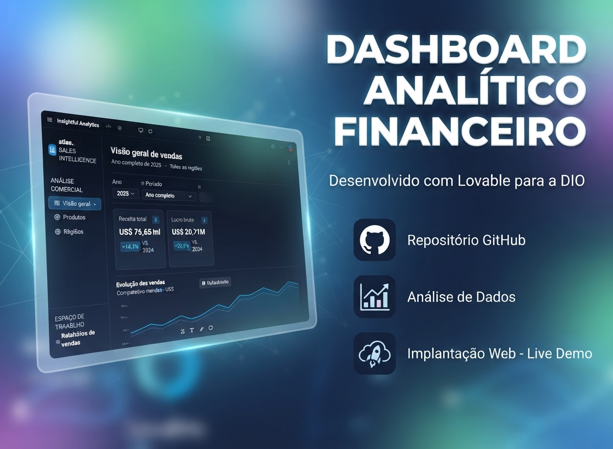

  

  
  
  
  

## Governança 4.0

Este repositório adota os padrões de **Governança 4.0**, garantindo automação, rastreabilidade e segurança contínua para o desenvolvimento solo:

* **Automação de Qualidade e Segurança:** Análises automatizadas e portas de verificação (*status checks*) ativas em segundo plano.
* **Fluxo Sem Atrito:** Dispensa de aprovações manuais redundantes com *auto-merge* habilitado para agilizar entregas.
* **Integridade de Código:** Proteção de branch e bloqueio de *force pushes* para garantir a estabilidade da base principal.

---

## 📋 Sobre o Projeto

Repositório oficial do projeto desenvolvido para a **DIO**, consistindo em um **dashboard analítico financeiro web interativo** de alta performance. A aplicação foi construída para fornecer insights gerenciais precisos, acompanhamento de indicadores de desempenho financeiro e simulações estratégicas em tempo real. O ecossistema integra código-fonte, base de dados estruturada em CSV, modelos em Power BI (`.pbix`), documentação técnica em relatório PDF e uma demonstração online totalmente funcional.

## 🛠️ Tecnologias e Arquitetura

* **Frontend & Web App:** Lovable (React / Tailwind CSS / TypeScript)
* **Estruturação de Dados:** Microsoft Excel / Power BI (`.pbix`) / Arquivo CSV (`aurora-bi-financial-sample.csv`)
* **Documentação Executiva:** Relatório técnico e executivo detalhado (`relatorio_analitico_financeiro_dio.pdf`)
* **Controle de Versão:** Git e GitHub

---

## 💻 PROJETOS E PORTFÓLIOS
- **App Ecosystem:** [tozato-ai-core.vercel.app](https://tozato-ai-core.vercel.app)
- **H-Folio:** [h-folio-l0.vercel.app](https://h-folio-l0.vercel.app)

## 🐙 CÓDIGO E REPOSITÓRIOS
- **GitHub:** [github.com/Rafael-TOZATO](https://github.com/Rafael-TOZATO)

## ✍️ ARTIGOS E PUBLICAÇÕES
- **Medium:** [medium.com/@ornelas.tozato](https://medium.com/@ornelas.tozato)

## 🪟 MICROSOFT LEARN
- **Perfil:** [rafaelornelastozato-2209](https://learn.microsoft.com/pt-br/users/rafaelornelastozato-2209)

## 📬 CONTATOS
- **E-mail:** ornelas.tozato@gmail.com
- **LinkedIn:** [rafaeltozato81](https://www.linkedin.com/in/rafaeltozato81)
- **GitHub:** [Rafael-TOZATO](https://github.com/Rafael-TOZATO)
- **Dev Hub:** [tozato-ai-core.vercel.app](https://tozato-ai-core.vercel.app)
